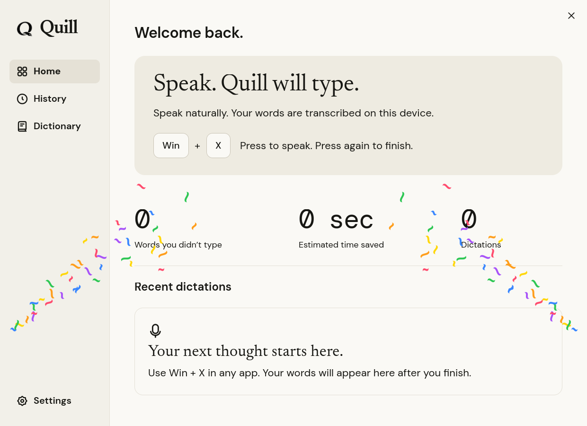

# Quill

> **Unofficial personal project.** Quill is homemade and independent. It is not affiliated with, endorsed by, or sponsored by Wispr Flow or its owners. “Wispr Flow” is a trademark of its respective owner.

I was inspired by Wispr Flow, but wanted dictation on **Arch Linux + Hyprland** using a local model. So I decided to try making my own with Qwen3-ASR running on my machine.

The native Rust/GTK4 dashboard shows words dictated, estimated typing time saved, and searchable local history. It also edits custom vocabulary and the typing-speed baseline. No account or subscription.



**Win+X** starts recording; press it again to stop. The capsule hides immediately; after local transcription with [transcribe.cpp](https://github.com/handy-computer/transcribe.cpp), Quill copies the text and sends Ctrl+Shift+V to the active window. Custom vocabulary terms from `keywords.txt` are passed to Qwen3-ASR during inference.

On my GPU, transcription after recording runs at about **70× real time**. Speed varies with the GPU, model, and audio.

The app records 16 kHz mono audio. Edit `keywords.txt` to add one custom term per line; Qwen3-ASR uses these as vocabulary hints and may still miss or alter a term. The model and recording are local files and are ignored by Git.

Backend selection is automatic: on this NVIDIA setup, CUDA is preferred; without an available GPU, the CLI can select CPU. If the automatic attempt fails (for example, a game leaves too little VRAM to load the model), the app retries the same recording once with `--backend cpu`. It keeps the same model and vocabulary, logs the failed attempt, and reports an error if CPU also fails. This bounded retry applies to any CLI process failure, so a missing or corrupt model still fails after the retry. A missing executable is reported immediately.

CPU transcription is slower and uses system RAM. The model is loaded for each transcription and released when the CLI exits; the next recording tries automatic selection again.

## Project layout

```text
Quill/
├── src/wisprflow/                  # all dictation app code
│   ├── __init__.py
│   ├── main.py                     # capsule UI and shortcut toggle
│   ├── transcriber.py              # recording, local ASR, CPU retry
│   └── history.py                  # private local SQLite history
├── desktop/                       # native Rust/GTK4 dashboard
│   ├── src/                       # pages, history reads, preferences
│   ├── assets/                    # bundled fonts, icons, and licenses
│   ├── style.css                  # cream/black theme and readable type
│   └── Cargo.toml
├── tests/                         # regression tests (unittest)
├── README.md
├── pyproject.toml                  # Python dependencies
├── uv.lock                         # locked Python dependency versions
├── .python-version
├── .gitignore
├── keywords.txt                    # custom terms passed to Qwen3-ASR
├── model/                          # download the GGUF model here (ignored)
│   └── Qwen3-ASR-1.7B-Q4_K_M.gguf
├── transcribe.cpp/                 # upstream clone (ignored, separate Git repo)
│   └── build/bin/transcribe-cli    # built by CMake
├── 1.wav                           # recording created by the app (ignored)
└── .venv/                          # created by `uv sync` (ignored)
```

`src/wisprflow/transcriber.py` resolves the model, CLI, vocabulary, and recording relative to the project root, independent of the working directory. Keep this source checkout in place: `uv sync` installs it as an editable package and creates `.venv/bin/quill` as the launcher. The internal package and toggle socket keep their `wisprflow` names, and the `wisprflow` command remains an alias for existing shortcuts.

## Requirements

These instructions are for Arch Linux and Hyprland. Install the system tools:

```bash
sudo pacman -S --needed base-devel cmake cuda portaudio tk wl-clipboard uv
```

The CUDA toolkit is needed for the NVIDIA build below. For a CPU-only build, skip `cuda` and turn off the CUDA option in the build command. Install a working NVIDIA driver for CUDA acceleration.

## Set up the Python app

From the project directory:

```bash
uv sync
```

This creates `.venv` and installs the locked Python dependencies. The app uses Tkinter for the capsule, PyAudio for recording, and `pyperclip` to copy the transcript. After completing the model and CLI setup below, launch it with:

```bash
uv run quill
```

Each invocation toggles recording in the running app, or starts the app and records if it is not running yet.

## Open the desktop dashboard

Install the native build dependencies (GTK ≥ 4.12 and Pango ≥ 1.56):

```bash
sudo pacman -S --needed rust gtk4 pango sqlite pkgconf
cargo build --locked --release --manifest-path desktop/Cargo.toml
./desktop/target/release/quill-desktop
```

For development, use `cargo run --locked --manifest-path desktop/Cargo.toml`. The dashboard and recording capsule are separate: closing the dashboard leaves Win+X working. Opening it again brings the existing dashboard forward. Drag the Quill wordmark to move the window; use the compositor's resize controls to resize it.

Keep the checkout in place: the dashboard locates fonts, icons, and `keywords.txt` relative to its compile-time source directory. Rebuild after moving the checkout. Fonts and icons are bundled, so the interface needs no network connection.

To add Quill to your application menu, run this from the project root after the release build:

```bash
mkdir -p ~/.local/share/applications
cat > ~/.local/share/applications/io.github.tk_hpc.Quill.desktop <<EOF
[Desktop Entry]
Type=Application
Name=Quill
Comment=Local dictation and history
Exec="$PWD/desktop/target/release/quill-desktop"
Icon=$PWD/desktop/assets/brand/quill-mark.png
Terminal=false
Categories=Utility;Accessibility;
StartupNotify=true
EOF
```

For square dashboard corners in Hyprland, add this alongside the capsule rule:

```lua
hl.window_rule({
    name = "quill-dashboard",
    match = { class = "^io.github.tk_hpc.Quill$" },
    rounding = 0,
})
```

## History, statistics, and vocabulary

- **Home** shows words you did not type, estimated time saved, dictation count, and the five most recent entries. It refreshes every two seconds while open. Monospaced counters count up on each Home click, and pages crossfade between destinations. A 1.4-second rainbow ribbon spray comes inward from both sides when Home opens. All motion respects GTK’s animation preference.
- **History** is a read-only list of transcripts with search and a Copy control. Rows omit dates and recording metadata. It loads 50 entries at a time. Search treats punctuation literally; case-insensitive matching covers ASCII, while other scripts match their original case.
- **Dictionary** edits the same `keywords.txt` used by the recording engine. Save applies to the next transcription. Unsaved changes are guarded on reload/close, and external file changes cause a conflict instead of being overwritten.
- **Settings** saves a typing baseline of 10–200 words per minute, initially 40. Estimated seconds saved are `max(0, words × 60 / typing WPM − recording seconds)`. This estimate excludes inference latency and correction time.

History begins with new successful transcriptions after updating/restarting the recorder. Existing recordings are not imported. Word counts recognize Unicode word groups and contractions; languages without word separators, including Thai and Chinese, do not receive linguistic word segmentation.

Transcripts are stored in `$XDG_DATA_HOME/quill/history.sqlite3`, defaulting to `~/.local/share/quill/history.sqlite3`. The directory is owner-only and the database is owner-readable/writable. History is local plaintext, not encrypted. Settings live in `$XDG_CONFIG_HOME/quill/preferences.ini`, defaulting to `~/.config/quill/preferences.ini`. Relative XDG paths use the default locations. The existing recorder also overwrites `1.wav` with the latest recording and prints transcribed text to its process output.

A history write failure is logged without dropping the transcript or preventing paste. A dashboard read failure displays an error instead of false zero totals. Neither dashboard use nor transcription sends audio or history to a server.

The interface uses bundled [DM Sans, DM Mono, and Newsreader](desktop/assets/fonts/SOURCES.md) under the SIL Open Font License and [Hugeicons Free Stroke Rounded](desktop/assets/icons/SOURCES.md) under MIT. Font/icon sources, modifications, and licenses are included beside the assets.

## Get and compile transcribe.cpp

If `transcribe.cpp/` is not already present, clone the upstream project into this directory. It is a separate Git repository and is intentionally ignored by this app's Git repository:

```bash
git clone https://github.com/handy-computer/transcribe.cpp.git
```

Build the CUDA CLI used by the app:

```bash
cd transcribe.cpp
cmake -B build \
  -DTRANSCRIBE_CUDA=ON \
  -DTRANSCRIBE_USE_SYSTEM_BLAS=OFF \
  -DCMAKE_BUILD_TYPE=Release
cmake --build build --target transcribe-cli -j"$(nproc)"
cd ..
```

For CPU-only, set `-DTRANSCRIBE_CUDA=OFF` (or omit the CUDA option) and build the same `transcribe-cli` target. The executable must end up at `transcribe.cpp/build/bin/transcribe-cli`. The CUDA build also supports `--backend cpu`, so automatic CPU fallback does not need a second build or model download.

## Download the model

Download the Q4_K_M model used by the app (about 1.32 GB):

```bash
mkdir -p model
curl -fL \
  'https://huggingface.co/handy-computer/Qwen3-ASR-1.7B-gguf/resolve/main/Qwen3-ASR-1.7B-Q4_K_M.gguf' \
  -o model/Qwen3-ASR-1.7B-Q4_K_M.gguf
```

The model is hosted in the [`handy-computer/Qwen3-ASR-1.7B-gguf`](https://huggingface.co/handy-computer/Qwen3-ASR-1.7B-gguf) repository. Other quantizations and details are in the upstream [Qwen3-ASR model guide](https://github.com/handy-computer/transcribe.cpp/blob/main/docs/models/qwen3-asr-1.7b.md).

## Add the shortcut and capsule to Hyprland

In `~/.config/hypr/hyprland.lua`, add a key binding. Replace `/path/to/Quill` with this project's directory:

```lua
hl.bind("SUPER + X", hl.dsp.exec_cmd(
    "/path/to/Quill/.venv/bin/quill"
))
```

If upgrading from WhisperScribe, run `uv sync` again and update the binding and window rule below. Stop any old app process while it is idle so the next Win+X press loads the updated code. The key combination and toggle socket are unchanged; the capsule title is now `Quill Capsule`.

Also add this window rule so the capsule floats at the bottom center without taking focus:

```lua
hl.window_rule({
    name  = "quill-capsule",
    match = { title = "^Quill Capsule$" },
    float = true,
    no_focus = true,
    no_blur = true,
    move = { "(monitor_w-window_w)/2", "monitor_h-window_h-48" },
})
```

Reload Hyprland:

```bash
hyprctl reload
```

Press **Win+X** once to start recording and again to stop and transcribe. Quill copies the transcript and sends Ctrl+Shift+V to the active window when transcription finishes. The CLI can also transcribe a 16 kHz mono WAV directly:

```bash
./transcribe.cpp/build/bin/transcribe-cli \
  -m model/Qwen3-ASR-1.7B-Q4_K_M.gguf \
  /path/to/audio-16k-mono.wav
```

Add `--backend cpu` to that command to test CPU inference directly.

Convert audio to the required format with FFmpeg if needed:

```bash
ffmpeg -i input.wav -ar 16000 -ac 1 /tmp/audio-16k-mono.wav
```

## Run tests

```bash
uv run --locked python -m unittest discover -s tests -v
cargo test --locked --manifest-path desktop/Cargo.toml
cargo clippy --locked --manifest-path desktop/Cargo.toml --all-targets -- -D warnings
cargo fmt --manifest-path desktop/Cargo.toml --check
uvx ruff check --ignore E712 src tests
uvx ty check src
```

The tests use temporary recordings, databases, preferences, and sockets and mock inference; they do not open the microphone, load the model, change the clipboard, or send paste shortcuts. They cover WAV output, CPU retry, history persistence and failures, search/statistics, counter interpolation, vocabulary conflicts, preference validation, and repeated-launch toggling. Explicit boolean comparisons are intentional for readability, so Ruff E712 and the equivalent Clippy lint are excluded.
